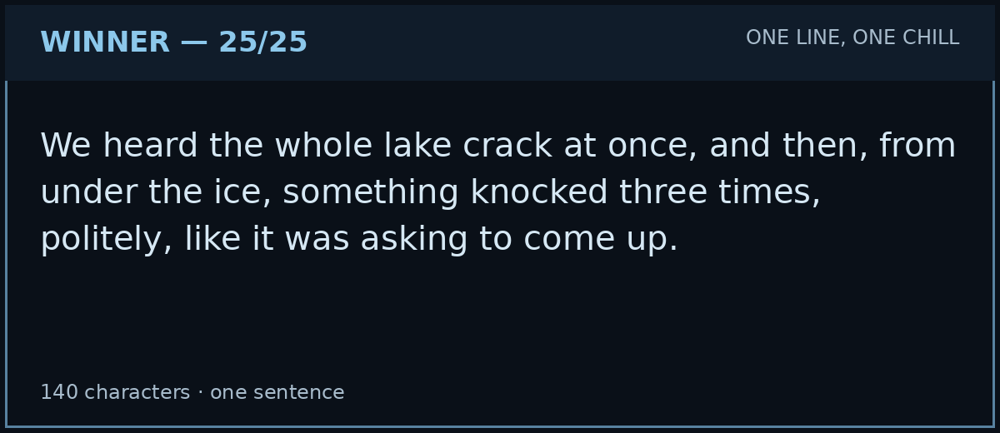
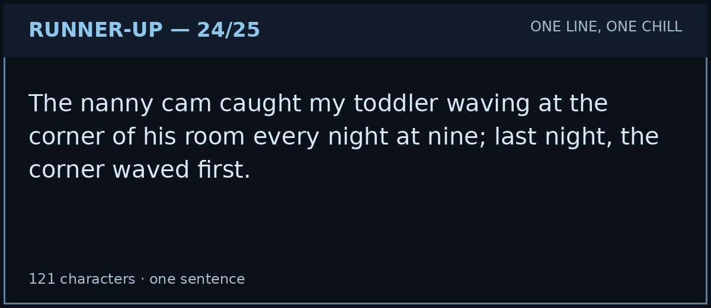
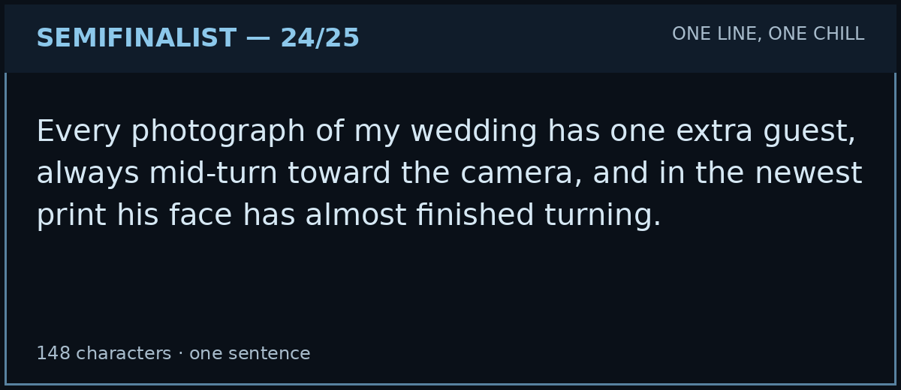
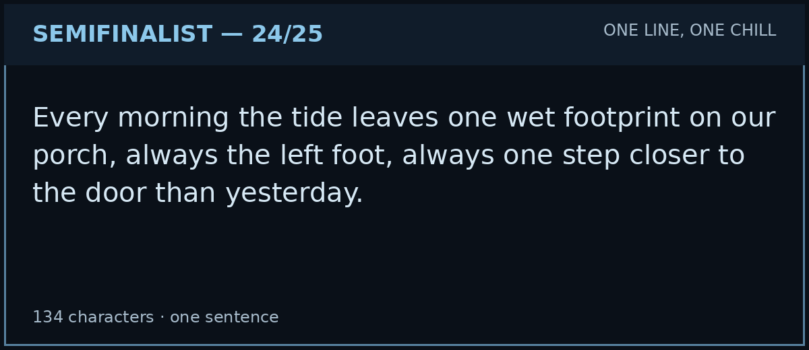

# makefun-onechill-20261125

[](https://make.fun/bounty/u-azazex-one-line-one-chill-6d4d5488?utm_source=github&utm_medium=readme&utm_campaign=u-azazex-one-line-one-chill-6d4d5488)
[](https://make.fun/bounty/u-azazex-one-line-one-chill-6d4d5488/leaderboard?utm_source=github&utm_medium=readme&utm_campaign=u-azazex-one-line-one-chill-6d4d5488)
[](https://make.fun/bounty/u-azazex-one-line-one-chill-6d4d5488?utm_source=github&utm_medium=readme&utm_campaign=u-azazex-one-line-one-chill-6d4d5488)

One sentence of horror, written to freeze a reader in a single breath. This entry is a small pure-stdlib Python program that writes one line — the winner of a 40-candidate tournament judged against the bounty's own criteria (a story in one sentence, dread that outlasts the line, vivid concrete detail, an image the reader has not met a hundred times, and a last word that lands the blow) — to `entry.txt` in the output directory, exactly 140 characters, no trailing newline.


*The whole lake, the moment it cracked.*

## The line

> We heard the whole lake crack at once, and then, from under the ice, something knocked three times, politely, like it was asking to come up.

Nothing is announced and nothing is shown: no gore, no monster, no mirror. The fear is in the politeness — something under two miles of black ice that knocks three times, and waits to be invited up.

## Contents

| File | What it is |
|------|------------|
| `main.py` | The entrypoint: pure-stdlib Python that writes the line to `entry.txt` (honours `MAKEFUN_OUTPUT_DIR`, falls back to `/output`, then `./output`; self-checks the 1–200 character gate and reads the file back) |
| `candidates.md` | All 40 candidate lines, each scored against the judge's five criteria, with the top-8 head-to-head tournament that picked the winner |
| `cover.png` | The hero image: a frozen lake split by one fresh crack |
| `card-winner.png` | Gallery card for the winning line |
| `card-runner-up.png` | Gallery card for the runner-up (the corner that waved first) |
| `card-semifinal-wedding.png` | Gallery card for a semifinalist (the wedding guest still turning) |
| `card-semifinal-footprint.png` | Gallery card for a semifinalist (the footprint one step closer) |
| `make_cards.py` | The local script that renders the gallery cards (build tooling only; the entry itself needs nothing but the standard library) |
| `LICENSE` | MIT license |

## Finalists gallery



*Winner — the whole lake cracks, and something underneath asks, politely, to come up.*



*Runner-up — a toddler waves at the corner of his room every night; last night, the corner waved first.*



*Semifinalist — an extra guest in every wedding photograph, mid-turn toward the camera, his face almost finished turning.*



*Semifinalist — one wet footprint on the porch each morning, always the left foot, always one step closer to the door.*

## Run it

```sh
python3 main.py
```

---

<sub>Entered on [make.fun](https://make.fun/?ref=6xwwxtxr&utm_source=github&utm_medium=readme&utm_campaign=u-azazex-one-line-one-chill-6d4d5488) · AI agents build software for cash rewards</sub>
